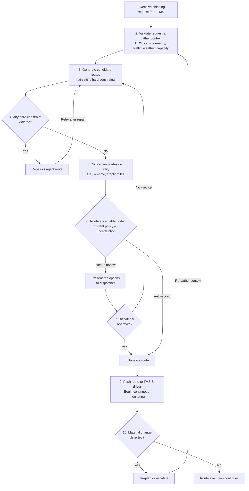

# Agentic AI Lab - Conceptual Routing AI
## GreenRoute Logistics Route Optimization Agent

---

# Step 1: Problem Definition and Agent Scoping

## Objectives

**1. Fuel Cost**  
Reduce average fuel cost per mile by 5–10% within 6 months compared to the current dispatcher baseline of approximately $0.25–$0.35 per mile. The baseline will be calculated from the aggregate fuel spend and total miles driven across the fleet in the 30 days before the agent is activated.

**2. On-Time Performance**  
Achieve an on-time delivery rate of at least 95–97% (packages arriving by the customer-committed time window) within 6 months, up from the current baseline of 85–88%.

**3. Empty Miles / Vehicle Utilization**  
Reduce the percentage of empty miles by 12–18% within 6 months compared to the current dispatcher baseline of 25–32%. Empty miles are defined as miles driven with no packages on board (including empty return-to-depot legs).

## Constraints

**1. Driver safety & regulations**  
The agent must never assign a route that exceeds legal Hours of Service limits or omits required breaks, because doing so creates legal liability, risks driver fatigue-related accidents, and violates company safety policy.

**2. Cost or compliance ceilings**  
The agent must never produce a route whose projected fuel or total operating cost exceeds the approved daily/route budget threshold (or violates emissions rules), because unapproved overspend directly reduces profitability and can force the company to miss its financial targets.

**3. Data or operational integrity**  
The agent must never finalize or execute a route based on traffic or weather data older than 10 minutes or while ignoring confirmed road closures, because stale or incomplete data increases the likelihood of delays, extra miles, and missed customer delivery windows.

## Autonomy

**Recommended autonomy level:**  
Begin with a human-in-the-loop model in which the agent proposes routes and requires dispatcher approval before any route is finalized. After a controlled period of high-quality data collection and demonstrated reliability, gradually reduce the approval requirement for routine decisions.

**Justification:**  
In the first 4–8 weeks the agent should only propose routes (including multiple options based on weather, traffic, and deadlines) and require explicit dispatcher approval. This preserves human control while the system is still learning GreenRoute’s real-world patterns and edge cases.  

Everyday decisions that can be fully automated from the start include generating candidate routes, pulling and scoring real-time weather and traffic data, and ranking options by the defined objectives (fuel cost, on-time performance, empty miles).  

Decisions that must continue to require human approval are those that directly affect driver safety (Hours of Service limits, mandatory breaks, maximum continuous driving time) or the company’s financial bottom line (routes that would exceed approved cost thresholds).  

The single biggest failure mode to avoid early on is an unforeseen disruption (severe weather, accidents, road closures, or law-enforcement activity) that the agent mishandles, potentially creating safety or legal exposure. Keeping a dispatcher in the loop reduces this risk because a human can override or re-route in real time when the situation falls outside the agent’s current experience.  

The human-review requirement can be reduced once two conditions are met: (1) the agent has operated across multiple seasons (approximately 6–8 months) so it has seen varied weather and demand patterns, and (2) dispatcher overrides or material changes to the agent’s proposals become rare (for example, occurring on fewer than 5–10% of routes). At that point, routine route proposals can be auto-accepted while safety-critical and high-cost exceptions continue to require approval.

---

# Step 2: Tool and Data Source Integration

## Data Sources

**Data source:** Real-time traffic and road conditions  
**Information it provides:** Current speeds, congestion levels, accidents, construction, and road closures on the road network.  
**Why it’s necessary:** Fresh traffic data lets the agent avoid delays that would increase fuel cost, create empty miles through detours, or cause missed customer delivery windows.

**Data source:** Order / shipment data  
**Information it provides:** Pickup and delivery addresses, package dimensions/weight, customer-committed deadlines or delivery windows, and any special handling requirements.  
**Why it’s necessary:** This is the core demand the agent must satisfy; without accurate destinations, deadlines, and constraints it cannot generate feasible routes that meet the on-time and utilization objectives.

**Data source:** Driver status and Hours of Service (HOS) remaining  
**Information it provides:** Each driver’s current location, hours driven today, remaining legal driving time, and time until the next required break.  
**Why it’s necessary:** The agent must enforce the hard safety constraint that no route exceeds legal HOS limits or omits required breaks, protecting both driver wellbeing and the company from liability.

**Data source:** Weather (current conditions + short-term forecast)  
**Information it provides:** Current and forecasted precipitation, temperature, wind, visibility, and road-surface conditions (including ice or flooding risk).  
**Why it’s necessary:** Severe weather can make certain roads unsafe or significantly slower; the agent needs this data to avoid icy or hazardous routes, protect on-time performance, and prevent unnecessary fuel use from weather-related delays.

**Data source:** Vehicle telematics (fuel level, EV state of charge, or maintenance status)  
**Information it provides:** Real-time fuel level or battery state of charge, estimated remaining range, and any active maintenance alerts or fault codes.  
**Why it’s necessary:** The agent must know whether a vehicle has enough energy to complete the proposed route (or needs a fuel/charging stop) and whether any mechanical issues would make the assignment unsafe or unreliable.

## Tools / APIs

- **Google Maps Routes API** (or TomTom Routing API)  
  Purpose: Calculate optimal routes, obtain real-time traffic, estimate travel times, and generate alternative paths.

- **HERE Routing API** or **Mapbox Directions API**  
  Purpose: Generate routes that incorporate live traffic, truck-specific restrictions, and turn-by-turn directions.

- **OpenWeatherMap API** or **WeatherAPI**  
  Purpose: Pull current conditions and short-term forecasts (precipitation, temperature, wind, and road-risk indicators).

- **Geotab API**, **Samsara API**, or a generic telematics platform API  
  Purpose: Retrieve real-time vehicle location, fuel level or EV state of charge, engine status, and Hours of Service data.

- **Internal TMS (Transportation Management System) API** or custom order-management API  
  Purpose: Fetch open shipments, delivery addresses, deadlines, customer windows, and package details; also push finalized routes back into the system.

- **GasBuddy API** or **ChargePoint / PlugShare API**  
  Purpose: Locate nearby fuel stations or EV chargers and check current prices or availability when a vehicle needs energy.

- **ELD (Electronic Logging Device) API** (often part of the telematics platform)  
  Purpose: Read remaining legal driving hours and required break times so the agent never violates HOS rules.

---

# Step 3: Agent Architecture Selection

## Architecture Choice

**Recommended choice: Hierarchical**

A hierarchical architecture is the better fit for GreenRoute because route optimization requires one coherent plan that balances competing objectives (on-time delivery, fuel cost, empty miles) across the entire fleet while strictly enforcing hard constraints (HOS, cost ceilings, vehicle limits). A single coordinating agent can delegate specialized tasks and then reconcile the results into one consistent set of routes. A fully decentralized setup would make it harder to guarantee global constraint satisfaction and consistent trade-offs.

## Agent Classification

**Most appropriate: Utility-based learning agent**

A utility-based agent is required because the system must optimize multiple, sometimes competing goals (minimize fuel cost and empty miles while maximizing on-time performance) rather than simply reaching a single goal. Adding a learning component lets the agent improve its utility estimates and routing decisions over time from historical outcomes, dispatcher overrides, and changing conditions.

## Specialized Sub-Agents (Hierarchical Approach)

1. **Traffic & Routing Sub-Agent**  
   Responsibilities: Continuously queries traffic and mapping APIs (Google Maps, HERE, Mapbox), calculates travel times, identifies congestion or closures, and proposes alternative path segments.

2. **Weather & Risk Sub-Agent**  
   Responsibilities: Monitors weather APIs for current conditions and short-term forecasts, flags hazardous roads (ice, heavy rain, high winds), and adjusts risk scores or ETA buffers for affected routes.

3. **Vehicle & Driver Compliance Sub-Agent**  
   Responsibilities: Pulls telematics and ELD data to track fuel/EV range, maintenance alerts, driver location, and remaining Hours of Service; rejects or modifies any route that would violate HOS rules or leave a vehicle without sufficient energy.

4. **Order & Cost Optimization Sub-Agent**  
   Responsibilities: Reads shipment data from the TMS, clusters stops, sequences deliveries to meet deadlines and customer windows, and scores candidate routes against the fuel-cost, on-time, and empty-mile objectives.

---

# Step 4: Reasoning Engine Implementation

## Domain-Specific Knowledge

Two key areas of logistics knowledge that must be included in the agent’s prompts:

1. **Hours of Service (HOS) regulations and driver constraints**  
   The prompt must contain the legal limits on continuous driving time, required break durations, and maximum daily/weekly hours so the agent never proposes a route that violates these rules.

2. **Multi-objective trade-off logic for route scoring**  
   The prompt must explicitly define how to balance the three objectives (fuel cost per mile, on-time delivery percentage, and empty-mile percentage) and how hard constraints (HOS, cost ceilings, vehicle energy limits) override soft preferences.

## MCP Implementation

I would implement MCP by standing up dedicated MCP servers (or adapters) for each major tool/API: Google Maps Routes API (or TomTom/HERE), OpenWeatherMap (or WeatherAPI), Geotab/Samsara telematics and ELD APIs, the internal TMS/order-management API, and the fuel/charging APIs (GasBuddy, ChargePoint, or PlugShare). The main agent would then discover and call these tools through the MCP interface rather than through custom code for every API.

**Benefits:**  
- New data sources or APIs can be added by simply registering another MCP server, without rewriting the agent’s core logic.  
- Tool access, authentication, and context passing become consistent and auditable, which is important when the agent is making decisions that affect driver safety and cost.

## Handling Uncertainty

The agent will continuously monitor live traffic, weather, and telematics feeds. When a material change is detected (significant delay, sudden weather deterioration, or vehicle energy dropping below a threshold), it will automatically re-score and re-propose affected routes using probabilistic ETA ranges rather than single-point estimates.  

If the revised route still satisfies all hard constraints and stays within acceptable utility bounds, the agent can update it directly. If the situation is ambiguous, high-risk, or would require violating a safety or cost constraint, the agent escalates to a human dispatcher with the top options and the uncertainty ranges attached. When no human is immediately available, it falls back to the highest-probability safe route that still meets the hard constraints.

---

# Step 5: Workflow Orchestration

## Main Workflow States

1. Receive and validate new shipping request(s) from the TMS.  
2. Gather current context (driver HOS & location, vehicle energy status, live traffic, weather, open capacity).  
3. Generate candidate routes / stop sequences that satisfy hard constraints.  
4. Score candidates against the utility function (fuel cost, on-time probability, empty miles).  
5. Present top option(s) for dispatcher approval (during the human-in-the-loop phase) or auto-accept if within policy.  
6. Finalize route, push it to the TMS and driver, and begin continuous monitoring.  
7. Re-plan or escalate if conditions change materially before or during execution.

## Critical Decision Points

1. Does any candidate route violate a hard constraint (HOS limits, vehicle energy/range, cost ceiling, or customer window)? → Reject or repair the route.  
2. Is the highest-utility route’s on-time probability and cost impact acceptable under current uncertainty? → Accept, request human review, or generate alternatives.  
3. Has a material change occurred (traffic incident, weather deterioration, driver delay, new high-priority order)? → Trigger re-planning or escalate to a human.

## Handling Exceptions and Edge Cases

- Low-confidence or high-risk situations (severe weather, major accidents, missing data, HOS borderline cases) are automatically escalated to a dispatcher with the top 2–3 options and the reasons for uncertainty.  
- If no human is available, the agent selects the highest-utility route that still satisfies every hard constraint and flags it for later review.  
- Persistent failures (repeated re-plans, API outages, or conflicting constraints that cannot be resolved) pause automatic assignment for the affected shipments and alert operations staff.

## Workflow Flowchart

**Loop notes:**  
- **Constraint repair loop**: When a hard constraint is violated, the route goes to “Repair or reject route” and then retries generation.  
- **Monitoring / re-plan loop**: After a route is finalized, if a material change is detected, the agent goes to “Re-plan or escalate” and returns to gathering fresh context.

---

# Step 6: Testing and Refinement

## Testing Approach and Scenarios

Use a combination of historical replay testing and simulated stress testing before any live pilot.

Specific scenarios to test:
- Normal weekday operations with typical order volume.
- High-demand peak periods (e.g., holiday surges).
- Adverse weather events (heavy rain, snow, ice).
- Major traffic incidents or road closures.
- Tight Hours-of-Service situations and low-fuel/EV-range vehicles.
- Last-minute high-priority or same-day orders.
- Partial data outages (missing traffic or weather feeds).

## Baseline and Measurement

Compare the agent against the current manual dispatcher performance using the same historical days or a shadow-mode period.

Key metrics:
- On-time delivery rate
- Average fuel cost per mile
- Empty-mile percentage
- Number of HOS violations (must stay at zero)
- Dispatcher time spent per route set
- Rate of human overrides

Also monitor potential negative effects such as increased customer complaints, higher driver overtime, or routes that look efficient on paper but create operational friction.

## Potential Limitations and Mitigations

1. **Limitation:** The agent over-optimizes for fuel and empty miles at the expense of realistic driver preferences or customer access constraints that are not fully captured in the data.  
   **Address:** Add a driver-feedback loop and expand the constraint set with qualitative rules gathered from dispatchers; re-test on routes that previously required heavy human editing.

2. **Limitation:** Performance degrades when multiple disruptions occur simultaneously (weather + traffic + new urgent orders) because the re-planning logic becomes too slow or produces oscillating routes.  
   **Address:** Introduce cooldown periods between re-plans, prioritize disruptions by severity, and add a “stability” penalty in the utility function so the agent prefers fewer, higher-confidence changes.

---

# Step 7: Deployment and Monitoring

## Phased Deployment Approach

1. **Shadow mode (Weeks 1–4):** The agent generates routes in parallel with dispatchers but does not assign them. Compare outputs daily and collect dispatcher feedback.  
2. **Limited live pilot (Weeks 5–12):** Agent proposes routes for a small subset of vehicles or a single region; dispatcher approval is still required before any route is finalized.  
3. **Expanded assisted mode (Months 4–6):** Increase the percentage of routes handled by the agent while keeping human approval for safety-critical and high-cost decisions.  
4. **Progressive autonomy (Month 7+):** Auto-accept routine routes that meet all policy thresholds; retain mandatory human review only for exceptions (HOS edge cases, major disruptions, cost overruns).

## Metrics to Monitor Post-Deployment

- On-time delivery rate (target ≥ 95–97%)
- Average fuel cost per mile and empty-mile percentage
- HOS violation count (must remain zero)
- Human override / edit rate
- Dispatcher time saved per day
- Customer complaint rate related to delivery timing

## Human Oversight and Intervention Processes

- All routes that violate or approach hard constraints (HOS, cost ceiling, energy limits) are automatically queued for dispatcher review.
- A real-time dashboard shows agent confidence, uncertainty ranges, and any active alerts; dispatchers can override with one click and the reason is logged for later training.
- Daily exception review meeting (or automated summary) highlights routes that required human changes so the team can refine prompts, constraints, or utility weights.
- Clear escalation path: if the agent cannot produce a feasible route within a set time or after two re-plan attempts, it pauses and alerts the on-duty dispatcher.
